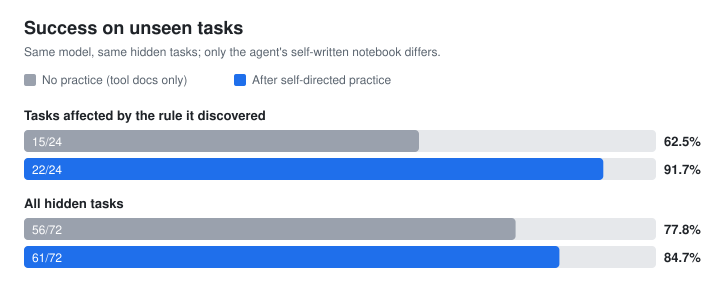
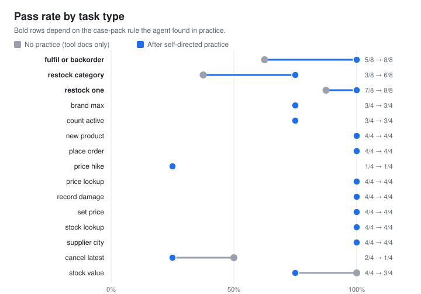

# Autodidact

**An LLM agent that teaches itself to use software it has never seen.**

It practises in a sandbox copy of an unfamiliar app, sets its own exercises,
checks every result against what it expected, and writes itself a notebook of
lessons. Then it is tested on hidden tasks, in a shop with different data, with
no human examples at any point.



## Result

Same model (`gemini-3.5-flash-lite`), same 60 hidden tasks, plus a repeat
attempt on the 12 tasks that depend on case packs. The only difference between
the two runs is the notebook the agent wrote during 15 practice episodes.

| | No practice | After practice | Fixed / broken | McNemar p |
|---|---|---|---|---|
| Tasks affected by the rule it discovered | 15/24 (62.5%) | **22/24 (91.7%)** | 7 / 0 | **0.016** |
| All hidden tasks | 56/72 (77.8%) | 61/72 (84.7%) | 7 / 2 | 0.18 |

During practice the agent discovered, with no hint anywhere in its prompts,
that purchase-order quantities count **case packs, not units**. On the hidden
test, every attempt that changed outcome on those tasks changed for the better.
In one replayed attempt the agent without its notebook ordered 20 packs
(200 units) to reach a target of 43; with its notebook it worked out
`23 + 3 × 10 = 53` and ordered 3.



**Limits, stated plainly.**

- The gain is concentrated where it learned something; across all attempts the
  change is not statistically significant on its own.
- It never discovered the pagination rules, so "every record" and "most recent"
  tasks did not improve.
- Cost per attempt went up by about 20% (21k to 26k tokens): with its notebook
  the agent reads more data before acting.
- The affected group was identified after the first exam run. The repeat
  attempts were run afterwards to check it and reproduced the gain
  (8/12 to 11/12).
- One small model and one sandbox app. A second app for a transfer test is next.

Every number here is computed from the raw results in [`results/`](results/),
including all 144 transcripts. The [replay site](docs/index.html) shows each
attempt side by side, without and with the notebook.

### How it got here

| Step | What happened |
|---|---|
| StockRoom v1, no practice | 80% on 15 tasks: too easy. The agent recovers from errors, so error-only traps leave nothing to learn. |
| StockRoom v2, no practice | Still 80%, but on the same 15 tasks it needed 54% more requests (4.1 to 6.3 per task): silent traps make it stumble. On all 60 tasks, 10 of 12 failures come from learnable traps, including one attempt where it **forged its own pagination cursor**, skipped the last two pages and missed three products it had to update. |
| Learner v1 | The notebook only restated the tool docs. In one transcript the agent ordered 6 of a 6-pack item, saw stock rise by 36 and reported "no surprises". |
| Learner v2 | Practice now states expectations and compares numbers. The notebook found case packs, inactive suppliers, MOQ rules and SKU rules. |
| Learned exam + repeat | The results above. |

## What exists so far

### StockRoom: the unfamiliar software

A small inventory app (products, suppliers, purchase orders, sales orders),
exposed as an **MCP server** with 23 tools. Its tool descriptions are terse,
like real internal API docs, and leave out fourteen deliberate quirks the agent
has to discover by itself.

**Silent traps** give no error at all, just a wrong result. These are what a
capable model with no experience actually fails on:

| Quirk | What goes wrong if you don't know it |
|---|---|
| `update_product_price` takes a bare `price`, in paise | "Set it to ₹78" stores ₹0.78 |
| Purchase orders count case packs, not units | Ordering 13 of a 12-pack item delivers 156 units |
| The category filter takes the code (`DRY`), not the name | Filtering by "Dairy" returns an empty list |
| Lists are paginated (`next_cursor`) | Counts and totals silently miss products |
| Archived products are hidden by default | "Next free SKU" collides with an archived one |
| Search returns at most 5 results | "Most expensive Nimbus product" picks the wrong one |
| Sales orders list oldest first | "Most recent order" is on a later page |
| The main supplier is not always the cheapest | Overpaying on restocks |

**Error traps** cost steps, but the error gives a hint:

| Quirk | What the agent sees |
|---|---|
| Inactive suppliers still appear in quotes; drafts to them are accepted | Submitting fails, and the abandoned draft stays behind unless cancelled |
| SKU prefix must match the category code | `sku rejected` |
| Stock adjustments need a reason from a hidden list | `reason not accepted` |
| Purchase orders: draft, then submitted, then received | `cannot do that in its current state` |
| Minimum order quantities | `quantity rejected for one or more lines` |
| Page size is capped at 20 | `invalid page_size` |

Version 1 of StockRoom had mostly error traps. The baseline agent scored 80%
on it, because it reads errors well and recovers. That left too little room to
measure learning, so version 2 adds the silent traps above. Each one is proven
decisive by a test that plays the naive strategy and fails the task.

Worlds are generated from a seed. The **test world** is reserved for hidden
evaluation; the agent only ever practises on other seeds, so it cannot memorise
answers.

### 60 hidden test tasks

15 templates x 4 instances, in three tiers (20 easy, 20 medium, 20 hard), from
"How many units of STP-0188 are in stock?" to "Restock every low Dairy product
from its cheapest supplier that is still accepting orders, ordering as little as
allowed, and receive the deliveries." Where a template can probe a trap, its
instances are chosen so that they do.

Every task has an automatic checker that diffs the whole database before and
after the episode, so doing the right thing *plus* something unasked for fails.
Mistakes the agent fully undoes itself (an order it placed and then cancelled)
are forgiven.

The test suite proves the evaluation is fair:

- a scripted reference solution, using only the MCP tools, passes all 60 tasks;
- doing nothing fails every task that asks for a change;
- a wrong answer fails every question;
- a correct solution plus one unrelated change fails;
- the naive strategy for each silent trap fails.

### The agent

A plain think, act, observe loop over the MCP tools, plus an exact
`calculate` tool (so arithmetic slips are not mistaken for app knowledge),
ending with a `finish` call. Its system prompt is generic (it never mentions StockRoom) and identical
in every experiment. The only thing that changes between "no practice" and
"after practice" is a block of knowledge the agent wrote for itself, so any
improvement is attributable to learning.

### Self-directed learning (`autodidact learn`)

Each practice episode runs in a fresh practice shop (never the hidden test shop):

1. **Curriculum.** The model proposes an exercise from the tool list, which
   tools are under-explored, what it has learned and what it tried before.
   Exercises describe records ("a product that is running low") instead of
   naming them.
2. **Practice with read-back.** The agent does the exercise using everything it
   has learned so far, then verifies the result by reading data back. That is
   how silent traps surface: "I ordered 9 and stock rose by 54?"
3. **Reflection.** The model writes up to three general lessons and marks
   existing ones as confirmed or contradicted. Lessons contradicted more often
   than confirmed are retired.
4. **Consolidation** every few episodes merges duplicates and resolves
   conflicts, keeping evidence counts.

Guards against cheating and noise:

- every prompt is domain-neutral (none mentions packs, paise or pagination),
  so the traps have to be discovered;
- a **leak filter** rejects any lesson that names a specific record (ids, SKUs,
  or supplier, customer and brand names); lessons must be about the application,
  not one shop's data;
- a **contamination report** gives each practice exercise's word overlap with
  its closest hidden task, and counts near-copies;
- a **naive-memory ablation** gives the agent the same practice experience as
  raw transcripts, with no reflection, to show what reflection itself adds
  (built and tested; not yet run on the real model).

The notebook (`knowledge.md`) is the only thing that differs between the
"docs only" and "learned" conditions.

**What the first run taught me (learner v1 to v2).** The first 10 practice
episodes produced a notebook that only restated the tool descriptions and found
none of the traps. The transcripts showed why: in one exercise the agent ordered
6 of a 6-pack item, watched stock rise from 149 to 185, and reported "no
surprises". It never said what it expected, so nothing could surprise it.
Learner v2 changes three things, all still domain-neutral:

- practice states the expected effect of each change before acting and reports
  `EXPECTED vs ACTUAL` with exact numbers;
- reflection gets the tool descriptions, recomputes before/after differences
  itself, and may only keep what the descriptions do not already say;
- the curriculum favours exact-answer and all-records requests with varied
  inputs, where silent rules show up, over "check that tool X works".

A test enforces that no learning prompt mentions any StockRoom concept.

### Built for free API tiers

Free tiers limit requests per minute and per day, so the harness is designed
around them:

- **One client for Groq and Gemini** through their OpenAI-compatible endpoints,
  with MCP schemas reduced to a subset both accept.
- **Pacing** keeps requests under the per-minute limit instead of colliding with it.
- **Short limits** are waited out; **daily limits** stop the run at once.
- **Resumable runs**: each result is saved as soon as it is graded, so running
  the same command after the quota resets continues where it stopped.
- **Response cache**: an identical request is never paid for twice.
- **Context compaction**: older tool results are shortened to save tokens.
- **History safety**: assistant messages are sent back byte-for-byte, so
  Gemini's hidden thought signatures on tool calls survive multi-turn use.

Results come with 95% confidence intervals, because on 60 tasks a few points
of difference can be noise.

## Run it (Windows PowerShell)

```powershell
python -m venv .venv
.venv\Scripts\Activate.ps1
pip install -e ".[dev]"
copy .env.example .env          # then paste your keys into .env
pytest                          # no network needed
autodidact doctor               # real two-turn tool-calling test per provider
autodidact eval --per-template 1                 # 15 tasks: a quick baseline
autodidact eval                                  # all 60 tasks
autodidact learn                                 # 15 practice episodes, ~150 requests
autodidact eval --condition learned --knowledge learn\stockroom-v2__learner-v2__gemini-gemini-3.5-flash-lite\knowledge.md
autodidact eval --condition naive-memory --knowledge learn\stockroom-v2__learner-v2__gemini-gemini-3.5-flash-lite\naive_memory.md
autodidact report runs\docs-only__stockroom-v2__gemini-gemini-3.5-flash-lite
autodidact show runs\docs-only__stockroom-v2__gemini-gemini-3.5-flash-lite inv-restock_one-1
```

Reproduce the published numbers and figures from the committed results (no API key needed):

```powershell
autodidact compare results\docs-only results\learned
python scripts\make_figures.py      # docs\figures\*.svg
python scripts\build_site.py        # docs\data.js for the replay site
```

StockRoom also runs as a standalone MCP server for any MCP client:
`autodidact-inventory-server --seed 1`.

## Layout

```
src/autodidact/
  envs/base.py               snapshots, diffs, money helpers
  envs/session.py            one episode over MCP
  envs/inventory/world.py    seeded world generator
  envs/inventory/app.py      StockRoom business logic and quirks
  envs/inventory/server.py   MCP server (in-process or stdio)
  envs/inventory/tasks.py    the 60 hidden tasks and their checkers
  tasks.py                   Task, CheckResult, answer parsing
  llm/openai_compat.py       Groq/Gemini client: pacing, retries, quota stops
  llm/schema.py              portable tool schemas
  llm/cache.py               on-disk response cache
  llm/providers.py           provider settings from .env
  agent/loop.py              the agent loop
  agent/calculator.py        exact, sandboxed arithmetic tool
  learn/session.py           curriculum, practice, reflection, consolidation
  learn/knowledge.py         lessons, evidence counts, leak filter
  learn/prompts.py           domain-neutral prompts
  eval/runner.py             resumable evaluation on the hidden tasks
  eval/contamination.py      practice-versus-exam overlap report
  eval/report.py             pass rates with confidence intervals
  eval/compare.py            paired before/after comparison, McNemar's exact test
  cli.py                     autodidact doctor | eval | learn | compare | report | show
results/                     raw results and transcripts behind every published number
scripts/                     regenerate the figures and the replay site from results/
docs/                        replay site (GitHub Pages) and figures
tests/                       tests; providers are simulated, no network
```
